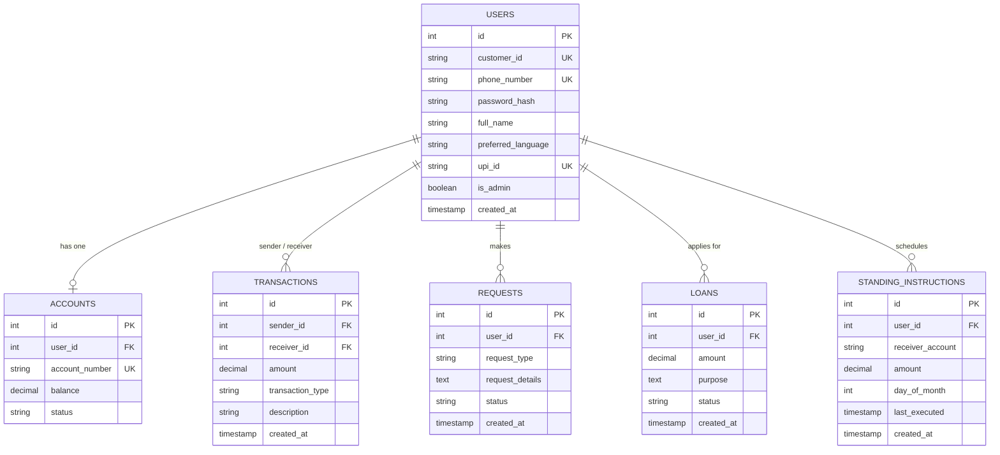

# SIRI BANK: Smart AI-Powered Banking System
### Comprehensive Product & Architecture Guide for Students

SIRI BANK is a prototype web application demonstrating a modern, responsive, and interactive digital banking experience. It combines a client-side portal, a secure admin-side back-office, a database ledger system, and an interactive AI chatbot assistant featuring voice commands and multi-lingual support.

---

## 1. System Architecture & Tech Stack

SIRI BANK is designed around a lightweight, high-performance architecture:

```mermaid
graph TD
    User([Customer / Admin Browser]) -->|HTTP Requests / JSON API| Flask[Flask Web Server (Python)]
    Flask -->|SQL Queries| DB[(SQLite Database: siri_bank.db)]
    Flask -->|Renders Templates| HTML[HTML5 / CSS3 / Vanilla JS]
    User -->|Voice Commands| WebSpeech[Web Speech API (Browser)]
```

### Core Technologies Used
1. **Frontend (User Interface):**
   - **HTML5 & Vanilla CSS3:** Styled with custom color palettes (Indigo, Slate, and Emerald) and interactive micro-animations (e.g., hover transforms, sliding widgets).
   - **JavaScript (ES6):** Handles client-side API requests, UI state management, simulated hardware interactions (OTP entry, Face Scan, Fingerprint Scan), and chatbot logic.
   - **FontAwesome & Google Fonts (Inter):** For sleek iconography and modern typography.
   - **Web Speech API:** Powering the voice recognition capability of the chatbot assistant.

2. **Backend (Application Logic):**
   - **Python (Flask):** Serves routes, manages sessions (login state, preferred language), and handles JSON endpoints for financial transactions.
   - **Gunicorn:** Configured as the production WSGI HTTP server (defined in `Procfile` for cloud deployment).

3. **Database (Ledger System):**
   - **SQLite (`siri_bank.db`):** An embedded relational database that holds information about accounts, users, requests, ledger entries (transactions), loans, and standing instructions.

---

## 2. Database Schema & Data Model

SIRI BANK uses a relational model to manage accounts, security credentials, request logs, and financial transactions. 

### Entity-Relationship Diagram (ERD)



### Table Definitions & Roles

* **`users`:** Stores core customer attributes, login configurations, preferred language, UPI identities, and the administrative flag (`is_admin`).
* **`accounts`:** Holds bank account balances, statuses (`ACTIVE` or `INACTIVE`), and links back to the user profiles.
* **`transactions`:** The central ledger capturing all money movements (Deposits, Withdrawals, and Peer-to-Peer Transfers).
* **`requests`:** An operations queue where users request services (like ATM Debit Cards or Aadhaar KYC links) for admins to review.
* **`loans`:** Manages debt requests, capturing loan amounts, user purposes, and underwriting statuses.
* **`standing_instructions`:** Stores automated, recurring monthly payment instructions (autopay).

---

## 3. Customer Portal walkthrough & User Flows

The Customer Portal provides a clean dashboard mimicking a real online banking app. Below is a detailed walkthrough of each module and how users interact with it.

### A. Login & Simulated Authentication
* **Location:** `/` (Login Page)
* **How it works:**
  - Standard login accepts either an **Aadhaar Number** or **Customer ID** along with a password.
  - **Simulated Fingerprint Auth:** Clicking this button runs a 1-second scan simulation, auto-fills credentials for the demo customer (Aadhaar `123456789001`), and logs them in instantly.
* **Demo Credentials:**
  - **Customer Login:** `123456789001` (Aadhaar) or `CUST1001` (Customer ID) / `123456` (Arpitha)
  - **Admin Login:** `ADMIN001` / `admin123` (System Administrator)

---

### B. Interactive Home Dashboard
* **Location:** `/home`
* **Features:**
  1. **Savings Balance Card (Slider):**
     - Shows the account balance, UPI ID, and account number.
     - **Privacy Eye Toggle:** Users can click the eye icon to hide/blur sensitive account parameters (`₹1,55,000` blurred out).
     - **Card Slider:** Dragging or clicking the slider dots navigates between the **SIRI Savings Account** and the **SIRI Platinum Credit Card** card views.
  2. **Credit Eligibility:**
     - Only verified customers (like `CUST1001` in the database seed) see the **Platinum Credit Card** detail (Limit: `₹5,00,000`). Other users see a locked card prompt requesting consistent history.
  3. **Sidebar Quick Actions:**
     - Selecting a quick action swaps the right sidebar panel dynamically to open specific banking wizards:
       - **Pay Phone:** Enters a 10-digit number and amount to transfer funds.
       - **Transfer:** Initiates standard bank-to-bank transfers.
       - **UPI Pay:** Transfers funds directly to a UPI address (e.g., `arpitha1@siri`).
       - **Limits:** Drag ranges to update Daily ATM and Online limits.
       - **Offers:** View current reward promotions (e.g., cashback on Amazon or fuel).
       - **Loan / Credit Services:** Opens a loan application form.
       - **Add Money:** Virtual gateway to deposit funds into the account using cards or UPI.
  4. **Activity Tabs:**
     - **Recent Activity:** Displays the latest transactions in real-time.

---

### C. ATM Services Module
* **Location:** `/atm-services`
* **Features:**
  - **Segmented Control:** Toggle switch between Debit Card and Credit Card profiles.
  - **Card Details Unmasking:** Clicking "View Details" decrypts CVV and Expiry fields and displays the card numbers on screen.
  - **Instant Blocking:** Clicking "Block Card" triggers a verification modal. If confirmed, the card visual applies a grayscale filter, a red `BLOCKED` stamp, and disables further operations.
  - **Reset PIN:** A modal to update the card's 4-digit security code.
  - **New Card Application:** Custom order form choosing card networks (Visa, Mastercard, RuPay), card tier, and shipping addresses. Submitting pushes a request into the admin queue.

---

### D. Aadhaar KYC Linking Wizard
* **Location:** `/aadhaar-kyc`
* **Features:**
  - Follows a strict **4-Step Verification Wizard**:
    1. **Details:** Input full legal name, Date of Birth, and 12-digit Aadhaar number.
    2. **OTP Verification:** Simulate a 6-digit one-time password security check. Pushes a request to the `/api/user/kyc/generate-otp` endpoint, generating a mock OTP that is displayed via toast, then verifies it using the `/api/user/kyc/verify-otp` endpoint.
    3. **Face Liveness Check:** Simulates biometrics. Clicking start triggers a radar sweep line across a face placeholder, prompting instructions: *"Blink your eyes..."* -> *"Turn your head left..."* -> *"Almost done..."* before completing.
    4. **Confirmation:** Sends verification logs to the database queue and updates the page with a success summary.
  - If the KYC is rejected by an Administrator, the user sees a dedicated rejection status screen displaying the exact administrative reason for the rejection.
  - Once verified, the page automatically switches to a static dashboard showing "KYC Verified" or "Pending Audit".

--### E. AI Chatbot Assistant & Voice Search (Conversational Gemini)
* **Location:** Single persistent floating widget in the bottom-right corner of the interface across all pages (seamless SPA navigation without resetting).
* **Features:**
  - **Conversational Gemini AI:** Powered by `gemini-2.5-flash` in `chatbot_logic.py`, providing natural, human-like banking conversations, explanations, and advice.
  - **Bilingual Excellence:** Full support for **Kannada (ಕನ್ನಡ)** and **English**. Hindi has been completely excised per accessibility guidelines.
  - **Hands-Free Wake Word Recognition:** Users who cannot read or type can simply say *"Hey Siri"*, *"Namaskara"* (ನಮಸ್ಕಾರ), *"Siri Bank"*, or *"Hey Gemini"*. The AI chimes instantly, opens the assistant, and begins listening.
  - **One-Shot Voice Commands:** Supports both wake word only (*"Namaskara"*) and combined one-shot utterances (*"Namaskara nanna balance eshtu"*), executing commands instantly.
  - **Voice Self-Registration:** Non-reading users can speak their name, phone number, Aadhaar, and password; the AI automatically fills the registration form with visual highlights.
  - **Acoustic Echo Prevention:** Speech recognition automatically mutes while the AI is speaking audio, preventing acoustic feedback loops.

---

## 4. Admin Portal Walkthrough & Operations

The Admin Portal acts as a bank teller window, compliance office, and back-office center. 

### A. New User Registration Approvals
* New self-registered accounts start in `PENDING` status and cannot log in until approved.
* Admins review applicant details (Name, Phone, Aadhaar) and can click **Approve** or **Reject** with custom feedback reasons.

### B. Dashboard Overview & Analytics
* **KPI Metrics:** Displays total active bank clients, pending registrations, outstanding service requests, and live database liquidity.
* **End of Day (EOD) Cron Run:** Admins can trigger the cron runner manually to execute standing instructions.

### C. Aadhaar KYC Approval Queue
* Shows submitted customer Aadhaar data for compliance verification.
* Admins can approve or reject with audit notes.

### D. Credit Underwriting (Loans)
* Lists submitted loan applications (Borrower, Amount, Purpose).
* **Loan Disbursement Flow:** When an admin clicks **Approve**, the system updates the loan table to `APPROVED`, deposits the amount into the customer's account, and creates a ledger audit entry.

### E. Card Issuance Queue
* Reviews requests for replacement cards (Network, Variant, Shipping address).

### F. Customer Directory & Teller Terminal
* Full customer directory with audit histories.
* Simulates physical cashier operations (Cash Deposit / Cash Withdrawal).

---

## 5. Typical Student Scenario Demonstrations

To demo the project's features in a presentation, run through these sequences:

### Scenario 1: Voice Wake Word & Balance Inquiry (Hands-Free in Kannada)
1. Open the banking portal. Without touching the keyboard or mouse, say: *"ನಮಸ್ಕಾರ"* or *"Hey Siri"*.
2. An instant pleasant chime sounds, the AI assistant expands, and the microphone begins listening.
3. Speak in Kannada: *"ನನ್ನ ಬ್ಯಾಲೆನ್ಸ್ ಎಷ್ಟು?"* (or one-shot: *"ನಮಸ್ಕಾರ ನನ್ನ ಬ್ಯಾಲೆನ್ಸ್ ಎಷ್ಟು"*).
4. SIRI Bank AI queries the active balance and responds conversationally in authentic Kannada text and natural neural voice.

### Scenario 2: Voice Self-Registration for Non-Reading Users
1. On the login page, say *"ಖಾತೆ ತೆರೆಯಿರಿ"* (open account) or *"Register new account"*.
2. Speak your details: *"My name is Suresh, phone 9876543210, aadhaar 123412341234, password 1234"*.
3. The AI extracts the fields, highlights each input in glowing green, and submits the application.
4. The system confirms the application is `PENDING` admin review.

### Scenario 3: Admin Approval Workflow
1. Log in to the Admin Portal (`ADMIN001` / `admin123`).
2. Go to the **User Approvals** tab.
3. Review Suresh's pending application and click **Approve**.
4. Log out and sign in as Suresh (`9876543210` / `1234`); access is granted with an initial bonus balance!
